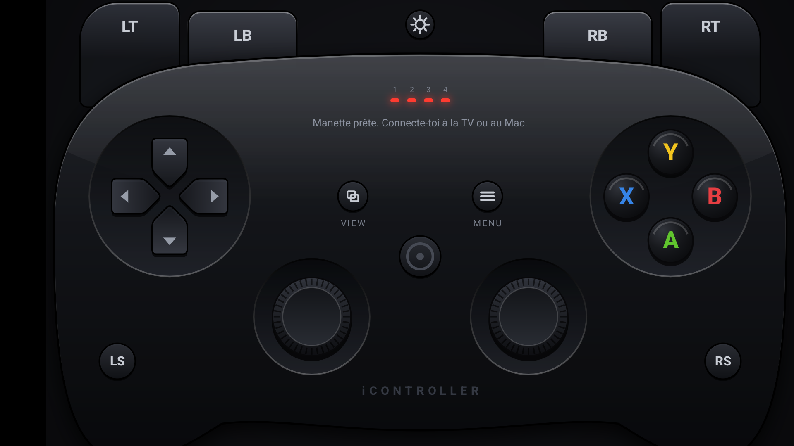
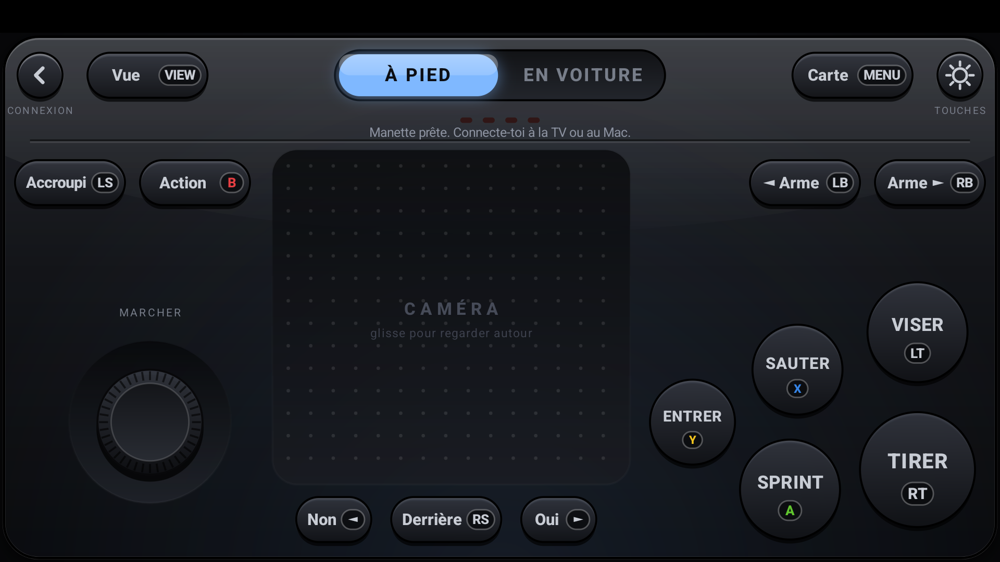
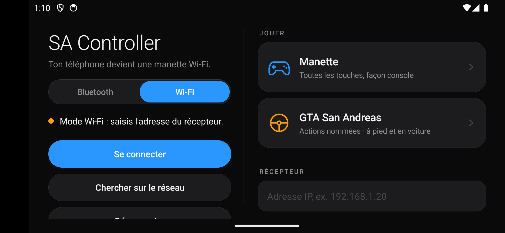

# SA Controller

Transforme un vieux téléphone Android en manette, en **Bluetooth** (reconnue nativement par une Android TV ou un Mac, sans rien installer) ou en **Wi-Fi** (vers un Mac, avec un petit récepteur fourni).

<p align="center">
  
  
  
</p>

> Version 0.6.1. L'appli n'a pas encore été testée sur un vrai appareil : voir [Limites](#compatibilité-et-limites).

## Fonctionnalités

**Manette classique**
Une manette tactile façon DualShock 3 (corps noir, sticks symétriques en bas, croix en quatre flèches, voyants 1 à 4) avec la disposition et les couleurs de touches Xbox : A B X Y, LB / RB, LT / RT, View, Menu, un bouton Home, clics de sticks (LS / RS), deux sticks analogiques.

**Écran GTA San Andreas**
- Deux modes, **À pied** et **En voiture**, avec chacun ses boutons nommés par action (Tirer, Viser, Sauter, Sprint, Entrer… ; Accélérer, Freiner, Frein à main, Klaxon, Radio…).
- Un stick de déplacement à gauche et une zone caméra au centre (on glisse le doigt pour regarder autour).
- En voiture, **conduite par inclinaison** : le téléphone sert de volant, avec un bouton « Recentrer » pour redéfinir la position neutre. L'angle de braquage à fond se règle (20°, 30° ou 45°).
- **Touches réassignables** : l'écran « Touches » permet d'attribuer à chaque action n'importe quelle touche de manette (ou aucune). Les réglages sont enregistrés sur le téléphone, avec un bouton pour revenir aux valeurs par défaut.
- Option pour changer de mode automatiquement quand on appuie sur Entrer / Sortir.

**Écran de connexion**
Recherche des appareils Bluetooth à proximité, association, connexion, déconnexion, et bouton « Rendre visible » pour que le téléphone puisse être associé depuis la TV ou le Mac. L'état de la connexion est affiché en clair.

## Compatibilité et limites

- **Android 9 minimum** (API 28) : l'appli utilise l'API `BluetoothHidDevice`, qui n'existe pas avant.
- **Certains fabricants désactivent ce mode HID** sur leurs téléphones. L'appli le détecte et l'indique à l'écran.
- **Android TV** : la manette est vue comme une manette Bluetooth standard.
- **Mac** : les applis qui lisent les manettes génériques (Chrome avec la Gamepad API, Steam / SDL, émulateurs) devraient la voir. En revanche, les jeux qui n'acceptent que les manettes Apple, Xbox ou PlayStation ne la reconnaîtront pas forcément.
- **Touches GTA par défaut = suppositions.** Elles sont calquées sur la disposition manette Xbox 360 de GTA San Andreas et n'ont pas été vérifiées dans le jeu. À ajuster dans l'écran « Touches ».
- **Wi-Fi : Mac uniquement pour l'instant.** Une Android TV ne laisse pas une appli ordinaire créer une manette virtuelle (il faut le root) : pour la TV, utilise le Bluetooth. Pas d'USB.
- **Wi-Fi côté Mac = clavier + souris**, pas une vraie manette : macOS n'a pas de manette virtuelle sans pilote signé. Le jeu doit donc accepter le clavier et la souris (voir la table des touches dans `recepteur-mac/sa-recepteur.py`).
- **Pas encore testé sur un vrai appareil** (v0.6.1). Le Wi-Fi a été vérifié entre l'émulateur Android et le récepteur Mac en mode test.

## Installation

L'APK est compilé automatiquement par GitHub (onglet **Releases** du dépôt, ou **Actions** › dernier run › Artifacts). Tu peux aussi le compiler toi-même ([voir plus bas](#compiler)).

1. Télécharge l'APK depuis la dernière release et copie-le sur le téléphone.
2. Autorise l'installation depuis des sources inconnues quand Android le demande.
3. Si Play Protect avertit (l'APK est signé avec une clé de test), choisis « Installer quand même ».
4. Au premier lancement, accepte les autorisations Bluetooth (« Appareils à proximité » sur Android 12 et plus ; la localisation sur Android 9 à 11, nécessaire à la recherche d'appareils).

## Connexion

**À une Android TV**
1. Sur la TV, ouvre les réglages Bluetooth (ajouter un accessoire).
2. Dans l'appli, touche **Chercher**, puis touche le nom de la TV.
3. Accepte le code d'association sur les deux écrans.
4. Une fois « Connecté », choisis **Manette** ou **GTA San Andreas**.

Variante : touche **Rendre visible**, puis associe le téléphone depuis la TV.

**À un Mac**
1. Ouvre Réglages Système › Bluetooth sur le Mac.
2. Dans l'appli, touche **Chercher**, puis touche le nom du Mac, et accepte le code. Sinon, touche **Rendre visible** et associe le téléphone depuis la liste du Mac.
3. Une fois « Connecté », choisis un écran de manette.

Le bouton **Déconnecter** coupe la liaison. Android retire l'enregistrement HID quand l'appli passe en arrière-plan : elle se réactive au retour au premier plan.

## Mode Wi-Fi (Mac)

En haut de l'écran de connexion, un sélecteur **Bluetooth / Wi-Fi** choisit la liaison (mémorisée). Le Bluetooth n'est pas modifié ; en mode Wi-Fi, il n'est pas utilisé.

**Principe** : le téléphone envoie son état complet (boutons, croix, sticks, gâchettes, mode à pied / en voiture) en **UDP**, sur le port 38492, vers l'adresse du Mac, ~20 fois par seconde et à chaque appui. Chaque paquet remplace le précédent : un paquet perdu ne coince jamais une touche. Le Mac répond par un accusé, ce qui allume le voyant vert. Si le téléphone se tait plus d'une seconde, le récepteur relâche tout. Le téléphone et le Mac doivent être sur le même réseau Wi-Fi (pas de « réseau invité » qui isole les appareils).

**Installer le récepteur sur le Mac** (rien à installer : Python 3 est déjà sur macOS)
1. Copie le dossier `recepteur-mac` sur le Mac.
2. Double-clique `lancer.command` (ou, dans Terminal : `python3 sa-recepteur.py`). Au premier lancement, macOS peut demander d'ouvrir le fichier : clic droit › Ouvrir.
3. Réglages Système › Confidentialité et sécurité › **Accessibilité** : autorise le Terminal, puis relance le récepteur. Sans cela macOS ignore les touches simulées.
4. Le récepteur affiche son adresse IP (ex. `192.168.1.20`).

<p align="center"></p>

**Se connecter**
1. Dans l'appli, choisis **Wi-Fi**.
2. Touche **Chercher sur le réseau** puis le nom du Mac, ou saisis l'adresse IP et touche **Se connecter**.
3. Voyant vert = connecté : l'écran de jeu s'ouvre. En cas de coupure, la reconnexion est automatique.

**Touches simulées** (modifiables en tête de `sa-recepteur.py`) : stick gauche = Z/Q/S/D (à pied) ou direction A/D (en voiture) ; stick droit = souris ; RT = clic gauche (à pied) ou W (accélérer) ; LT = clic droit ou S ; A = Espace ; X = Maj ; Y = F ; B = Entrée ; etc. `python3 sa-recepteur.py --test` affiche les événements sans rien injecter, pour vérifier la liaison ; `--souris 1.5` accélère la caméra.

**Android TV en Wi-Fi** : non pris en charge (voir Limites). Le protocole est documenté dans `WifiLink.java` si tu veux écrire un autre récepteur (Windows, Linux).

## Correspondance des touches HID

Pour les curieux : la manette se déclare comme « Game Pad » HID (rapport n° 1) avec 16 boutons, un hat, 4 axes et 2 gâchettes analogiques. L'ordre des boutons saute volontairement les boutons HID 3 et 6, que Linux / Android attribuent à C et Z, afin que les noms tombent juste.

| Touche affichée | Bouton HID | Remarque |
|---|---|---|
| A | 1 | |
| B | 2 | |
| X | 4 | |
| Y | 5 | |
| LB | 7 | |
| RB | 8 | |
| LT | 9 | envoie aussi l'axe Brake à 255 |
| RT | 10 | envoie aussi l'axe Accelerator à 255 |
| View | 11 | Select |
| Menu | 12 | Start |
| Home | 13 | Mode |
| LS | 14 | clic du stick gauche |
| RS | 15 | clic du stick droit |
| Croix | hat 0 à 7 | 8 = relâché |
| Stick gauche | axes X / Y | −127 à 127 |
| Stick droit | axes Z / Rz | −127 à 127 |
| Gâchettes | Accelerator (RT) / Brake (LT) | 0 à 255 |

## Compiler

Prérequis : JDK 17 et le SDK Android 34. Gradle 8.11.1 est fourni par le wrapper ; le plugin Android est en 8.7.3.

1. Crée un fichier `local.properties` à la racine (il n'est pas versionné) avec le chemin du SDK :

   ```properties
   sdk.dir=/chemin/vers/Android/sdk
   ```

2. Lance la compilation :

   ```bash
   ./gradlew assembleRelease
   ```

3. L'APK se trouve dans `app/build/outputs/apk/release/app-release.apk`.

## Structure du projet

Package `com.dynamicagence.icontroller`, dans `app/src/main/java/…` :

| Fichier | Rôle |
|---|---|
| `MainActivity.java` | Écran de connexion, permissions Bluetooth, recherche et association, bascule entre les écrans |
| `HidGamepad.java` | Enregistre le téléphone comme manette Bluetooth HID, décrit le rapport et envoie l'état des boutons et des axes |
| `GamepadView.java` | Manette classique tactile (boutons, croix, sticks) |
| `GtaView.java` | Écran GTA San Andreas : modes à pied / en voiture, caméra, conduite par inclinaison |
| `GtaKeys.java` | Liste des actions GTA, touche par défaut de chacune, enregistrement des réglages |
| `GtaSettingsView.java` | Écran « Touches » : réassignation des touches et options GTA |

## Version

v0.6.1 (versionCode 8), `minSdk 28`, `targetSdk 34`.

Réalisation : By Ligrade
